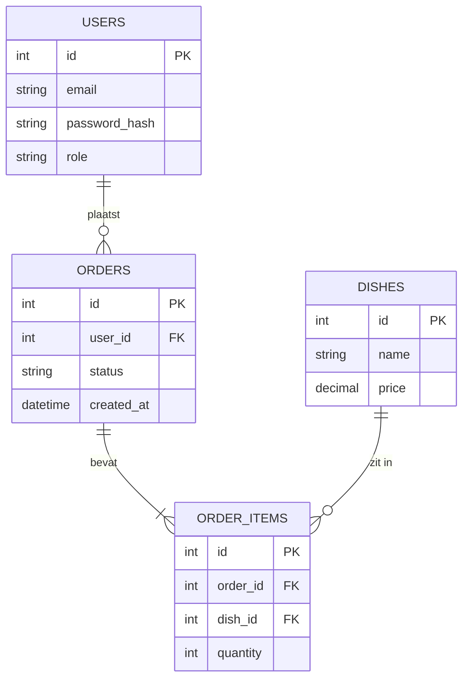

# Technisch Ontwerp

> **Deeloplevering 1 (einde week 2).** Houd dit document actueel: bij elke wijziging in tabellen,
> routes of rollen werk je het bij in dezelfde Pull Request.

**Team:** <!-- teamnaam en leden -->
**Projectcase:** <!-- Yume Ramen / Music Magnet Magazine / GLR Modellenbureau / GLR Crowdfunding -->

## 1. Architectuur in het kort

<!-- Eén alinea: welke onderdelen zijn er en hoe praten ze met elkaar?
Bijv. browser → public/*.php → src/ (logica) → MySQL (PDO). -->

## 2. ERD (database)

Het ERD moet overeenkomen met `database/schema.sql`. Vervang het voorbeeld door jullie eigen model.



### Toelichting op de keuzes

<!-- Waarom deze tabellen/relaties? Welke gegevens zijn persoonsgegevens (AVG) en hoe zijn die beveiligd? -->

## 3. Bestands- en paginastructuur

```
public/
  index.php
  assets/css/style.css
  assets/js/app.js
src/
  config/database.php
```

<!-- Vul aan met jullie eigen pagina's, classes en endpoints. -->

## 4. Routes en endpoints

| Pad | Methode | Doel | Rol / toegang | Eis |
| --- | --- | --- | --- | --- |
| `/index.php` | GET | Startpagina | publiek | E1 |
|  |  |  |  |  |

## 5. Rollen en rechten

| Rol | Mag | Mag niet |
| --- | --- | --- |
|  |  |  |

## 6. Goedgekeurde scope-afwijkingen

| Datum | Afwijking van het projectplan | Reden | Goedgekeurd door |
| --- | --- | --- | --- |
|  |  |  |  |

## 7. Wijzigingslog

| Datum | Wijziging | PR |
| --- | --- | --- |
|  |  |  |
